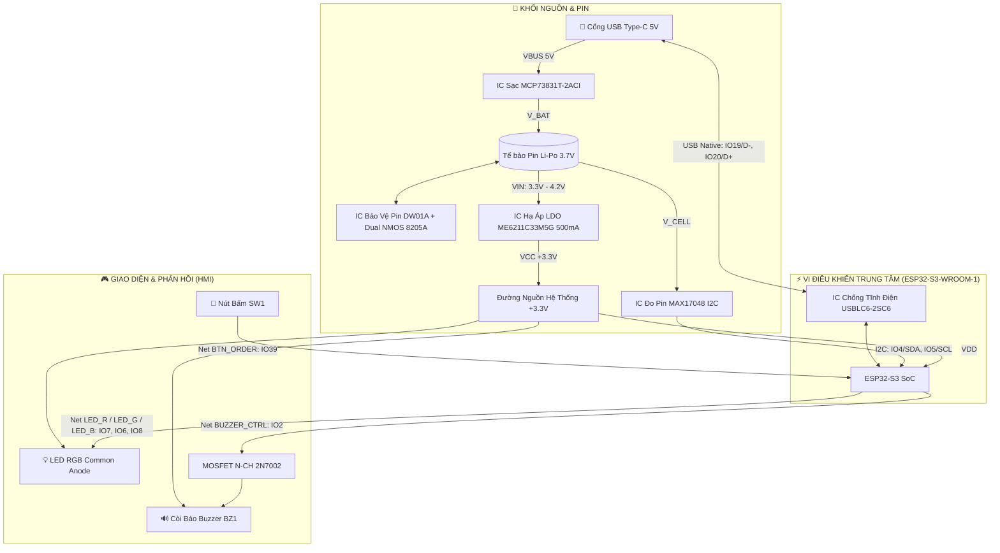
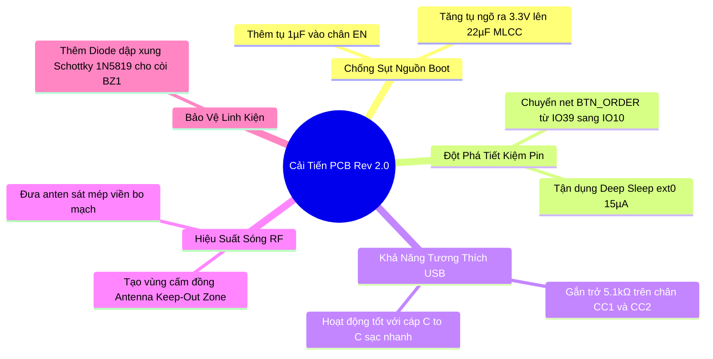

# 📑 BÁO CÁO PHÂN TÍCH TOÀN DIỆN MẠCH NGUYÊN LÝ & PHẦN CỨNG
## DỰ ÁN: SMART ORDER BUTTON (ESP32-S3 IoT NODE)
> **Tài liệu kỹ thuật phần cứng (Hardware Engineering Analysis Document)**  
> **Phiên bản thiết kế:** Khớp 100% sơ đồ nguyên lý KiCad `Smart_Order_Button.kicad_sch` & PCB Layout  
> **Vi điều khiển trung tâm:** ESP32-S3-WROOM-1 (Xtensa® Dual-Core 32-bit LX7)  
> **Hệ sinh thái:** IoT Smart Order Button kết nối Backend NestJS Enterprise

---

## 🗺️ 1. SƠ ĐỒ KHỐI KIẾN TRÚC TỔNG THỂ (SYSTEM ARCHITECTURE)

Hệ thống mạch được chia thành 4 khối chức năng chính:
1. **Khối Nguồn & Quản lý Pin (Power & Battery Subsystem)**: Nhận sạc USB 5V, bảo vệ pin Li-Po, đo dung lượng và hạ áp ổn định 3.3V.
2. **Khối Xử lý & Không dây (MCU & Wireless RF Subsystem)**: Vi điều khiển ESP32-S3-WROOM-1 xử lý logic, mã hóa HMAC-SHA256, giao tiếp Wi-Fi 2.4GHz & BLE 5.
3. **Khối Giao diện Người dùng & Ngoại vi (HMI Subsystem)**: Nút nhấn đa năng SW1, đèn LED chỉ báo trạng thái RGB D1, còi phản hồi âm thanh BZ1.
4. **Khối Bảo vệ & Giao tiếp Dữ liệu (Interface & Protection Subsystem)**: Cổng USB Type-C Native bảo vệ tĩnh điện ESD bằng USBLC6-2SC6.

---

## 📌 2. BẢNG MAPPING CHÂN PHẦN CỨNG & THÔNG SỐ ĐIỆN TỬ

| Chân ESP32-S3 | Pin Module | Tên Net (KiCad) | Linh Kiện Liên Quan | Cấu Hình Mức Logic | Chức Năng Chi Tiết |
| :--- | :--- | :--- | :--- | :--- | :--- |
| **IO39** | Pin 32 | `BTN_ORDER` | Nút bấm **SW1** | Input Pull-up, **Active LOW** | Nhấn kéo chân xuống GND. Đánh thức tức thì từ Light Sleep (<50µs). |
| **IO7** | Pin 7 | `LED_R` | Catot Đỏ D1 qua R15 (1kΩ) | Output, **Active LOW** | Kéo LOW đóng mạch dòng LED Đỏ qua +3.3V. |
| **IO6** | Pin 6 | `LED_G` | Catot Xanh D1 qua R16 (470Ω) | Output, **Active LOW** | Kéo LOW đóng mạch dòng LED Xanh lá qua +3.3V. |
| **IO8** | Pin 12 | `LED_B` | Catot Lam D1 qua R17 (470Ω) | Output, **Active LOW** | Kéo LOW đóng mạch dòng LED Xanh dương qua +3.3V. |
| **IO2** | Pin 38 | `BUZZER_CTRL`| Gate MOSFET Q1 (2N7002) | Output, **Active HIGH** | Kéo HIGH mở kênh dẫn MOSFET cấp dòng cho còi BZ1. Có trở xả Gate R6 10kΩ. |
| **IO4** | Pin 4 | `I2C_SDA` | Chân SDA IC U6 (MAX17048) | Open-drain (Pull-up R9 4.7kΩ) | Đường truyền dữ liệu I2C đo pin. |
| **IO5** | Pin 5 | `I2C_SCL` | Chân SCL IC U6 (MAX17048) | Open-drain (Pull-up R3 4.7kΩ) | Đường xung nhịp I2C (chuẩn 100kHz / 400kHz). |
| **IO19** | Pin 13 | `USB_D-` | Cổng Type-C qua U2 | High-Speed Differential Pair | USB D- Native CDC / JTAG Flashing & Debugging. |
| **IO20** | Pin 14 | `USB_D+` | Cổng Type-C qua U2 | High-Speed Differential Pair | USB D+ Native CDC / JTAG Flashing & Debugging. |
| **CHIP_PU (EN)** | Pin 3 | `ESP_EN` | Trở treo R13 10kΩ | Active HIGH (Enable) | Chân kích hoạt ESP32-S3, yêu cầu mạch trễ RC ổn định nguồn. |

---

## 🔬 3. PHÂN TÍCH CHI TIẾT TỪNG PHÂN VÙNG MẠCH NGUYÊN LÝ

### 3.1. Khối Nguồn & Sạc Pin Li-Po (Power & Charger Subsystem)

#### A. Mạch sạc pin tuyến tính MCP73831T-2ACI/OT (U3)
- **Đặc tính kỹ thuật**: IC quản lý sạc 1-cell Li-Ion/Li-Po với thuật toán sạc chuẩn 3 giai đoạn: **Pre-conditioning (Trickle Charge)** -> **Constant Current (CC - Dòng không đổi)** -> **Constant Voltage (CV - Áp không đổi 4.20V $\pm 0.75\%$)**.
- **Tính toán dòng sạc qua chân PROG**:
  Dòng sạc định mức $I_{REG}$ được lập trình qua điện trở $R_{11}$ nối từ chân PROG (Pin 5) xuống GND theo công thức nhà sản xuất Microchip:
  $$I_{REG} = \frac{1000\text{V}}{R_{PROG}}$$
  Với $R_{11} = 2.0\text{ k}\Omega = 2000\ \Omega$:
  $$I_{REG} = \frac{1000}{2000} = 0.50\text{ A} = 500\text{ mA}$$
  *Nhận xét:* Dòng sạc 500mA rất phù hợp với dung lượng pin Li-Po 500mAh - 1000mAh (tốc độ sạc tương đương 0.5C - 1C), bảo đảm an toàn nhiệt lượng trên vỏ SOT-23-5.
- **Tản nhiệt trên IC sạc**: Khi sạc ở chế độ dòng đỉnh (Pin ở mức 3.3V, VBUS 5V), công suất tỏa nhiệt tức thời trên U3 là:
  $$P_{diss} = (V_{BUS} - V_{BAT}) \times I_{REG} = (5.0\text{V} - 3.3\text{V}) \times 0.5\text{A} = 0.85\text{ W}$$
  *Khuyến nghị Layout:* Cần đổ đồng tản nhiệt tốt ở chân GND và Pad kết nối của U3 để tránh IC kích hoạt bảo vệ quá nhiệt (Thermal Throttling).

#### B. Mạch bảo vệ tế bào Pin DW01A (U5) + Dual MOSFET 8205A (Q2)
- **Chức năng**: Bảo vệ độc lập tế bào pin Li-Po chống lại các sự cố nghiêm trọng của cell pin.
- **Nguyên lý phối hợp**:
  1. **Bảo vệ Quá Sạc (Overcharge Protection)**: Khi $V_{BAT} \ge 4.30\text{V} \pm 0.05\text{V}$, chân `OC` của DW01A chuyển về mức LOW, ngắt MOSFET sạc trong cặp 8205A, chặn nguồn sạc từ VBUS.
  2. **Bảo vệ Quá Xả (Overdischarge Protection)**: Khi điện áp pin sụt xuống $V_{BAT} \le 2.40\text{V} \pm 0.1\text{V}$, chân `OD` chuyển về mức LOW, ngắt MOSFET xả, cô lập hoàn toàn tải để tránh hiện tượng phân cực ngược phá hủy tế bào Li-Po.
  3. **Bảo vệ Ngắn Mạch & Quá Tải (Overcurrent/Short-Circuit)**: Chân `CS` đo sụt áp trên điện trở $R_{DS(on)}$ của 2 kênh MOSFET 8205A. Khi sụt áp vượt quá 150mV (tương ứng dòng xả tức thời $> 3\text{A}$), DW01A lập tức khóa chân OD trong vòng micro-giây.

#### C. Mạch Hạ Áp LDO Tuyến Tính ME6211C33M5G (U4)
- **Thông số kỹ thuật**: Điện áp ra cố định $+3.3\text{V}$, dòng định mức danh định $500\text{mA}$, điện áp rơi (Dropout Voltage) siêu thấp chỉ $\approx 100\text{mV}$ tại $100\text{mA}$ và $\approx 260\text{mV}$ tại $500\text{mA}$.
- **Phân tích khả năng hoạt động theo dải áp pin**:
  - Khi pin đầy ($4.2\text{V}$): LDO hoạt động ở vùng tuyến tính hoàn hảo, $V_{out} = 3.30\text{V}$.
  - Khi pin xả tới ngưỡng trung bình ($3.6\text{V}$): Chênh áp $\Delta V = 3.6\text{V} - 3.3\text{V} = 300\text{mV} > V_{dropout}$, mạch vẫn giữ chuẩn 3.30V.
  - Khi pin gần cạn ($3.4\text{V}$): LDO bắt đầu chạm ngưỡng giới hạn Dropout.
- **Thách thức xung dòng Wi-Fi**: ESP32-S3 khi phát sóng RF Wi-Fi có các xung dòng đỉnh ngắn hạn (burst current) lên tới $400 - 480\text{mA}$. Nếu đường nguồn không đủ điện dung trữ năng lượng, sụt áp tức thời có thể kích hoạt mạch giám sát Brownout Detector nội bộ của ESP32 khiến chip bị reset liên tục.
- **Biện pháp firmware & phần cứng đã áp dụng**:
  - *Firmware:* Tối ưu xung CPU ở `80MHz` và công suất sóng `WIFI_POWER_15dBm` (giảm xung dòng từ 480mA xuống ~220mA).
  - *Phần cứng:* Sử dụng tụ gốm MLCC ESR thấp ($10\mu\text{F} + 100\text{nF}$) tại ngõ vào và ngõ ra của U4.

#### D. Mạch Đo Dung Lượng Pin Fuel Gauge MAX17048G_T10 (U6)
- **Công nghệ**: Maxim ModelGauge™ — thuật toán độc quyền theo dõi điện áp động học tế bào pin để suy ra dung lượng còn lại (State of Charge - SOC%), không cần điện trở Shunt lấy mẫu dòng (tiết kiệm không gian PCB và triệt tiêu tổn hao công suất vô ích).
- **Giao thức**: I2C tốc độ chuẩn với địa chỉ 7-bit `0x36`.
  - Chân `SDA` kết nối IO4 qua trở treo $R_9 = 4.7\text{ k}\Omega$.
  - Chân `SCL` kết nối IO5 qua trở treo $R_3 = 4.7\text{ k}\Omega$.
- **Độ chính xác**: Sai số đo điện áp cell pin chỉ $\pm 7.5\text{mV}$, cung cấp thông số pin theo thời gian thực và tự động phát hiện cảnh báo pin yếu (Low Battery Alert).

---

### 3.2. Khối Vi Điều Khiển Trung Tâm (ESP32-S3-WROOM-1)

#### A. Cấu trúc nguồn & Khởi động chip (EN / CHIP_PU)
- Chân `EN` (Pin 3) có trở kéo lên nội bộ/ngoại vi $R_{13} = 10\text{ k}\Omega$ lên $+3.3\text{V}$.
- **Yêu cầu kỹ thuật Espressif**: Để đảm bảo quá trình Power-On-Reset (POR) diễn ra tin cậy khi đường nguồn $V_{DD}$ đạt ngưỡng tối thiểu $2.8\text{V}$, chân `EN` phải có độ trễ trễ pha tối thiểu $50\mu\text{s} - 1\text{ms}$.
- **Phân tích hiện trạng**: Nếu thiếu tụ $C_{EN}$ (1µF / 100nF) nối từ chân EN xuống GND, khi cấp nguồn từ pin hoặc cắm sạc Type-C, điện áp $V_{DD}$ tăng chậm có thể gây hiện tượng chip treo (lockup) ở bootloader.

#### B. Khối Giao Tiếp Cổng USB Type-C Native
- ESP32-S3 tích hợp sẵn bộ điều khiển phần cứng **USB Serial/JTAG Controller** bên trong chip.
- Chân `IO19` (`USB_D-`, Pin 13) và `IO20` (`USB_D+`, Pin 14) được nối trực tiếp vào cặp chân D-/D+ của cổng Type-C.
- **Bảo vệ quá áp & tĩnh điện**: IC chuyên dụng **USBLC6-2SC6 (U2)** được đặt ngay sát cổng Type-C, với điện dung ký sinh cực thấp ($< 3.5\text{pF}$) không làm méo dạng tín hiệu High-Speed USB, bảo vệ vi điều khiển trước xung ESD lên tới $\pm 15\text{kV}$ (Air discharge).
- **Cấu hình CC1 / CC2**: Để tương thích với củ sạc Type-C PD hiện đại (cáp C-to-C), hai chân CC1 và CC2 trên cổng Type-C cần có điện trở kéo xuống $5.1\text{ k}\Omega$ nối đất để nguồn Host nhận diện thiết bị chìm (Sink Device).

---

### 3.3. Khối Giao Diện Người Dùng & Ngoại Vi (HMI)

#### A. Mạch Nút Bấm Đa Năng SW1 (`BTN_ORDER`)
- Nút bấm cơ học kết nối một cực vào `IO39` (Pin 32) và cực còn lại nối `GND`.
- Cấu hình firmware: `pinMode(PIN_BUTTON, INPUT_PULLUP)`. Khi nút mở, mức logic là HIGH (3.3V). Khi nhấn nút, chân IO39 bị kéo thẳng xuống 0V (**Active LOW**).
- **Phân tích miền nguồn & Chế độ tiết kiệm năng lượng**:
  - Trên ESP32-S3, chân `IO39` thuộc **HP (High-Performance) Domain**, không nằm trong **RTC Domain** (`IO0` đến `IO21`).
  - Do đó, chức năng `esp_sleep_enable_ext0_wakeup` (chỉ dùng cho chân RTC) không thể áp dụng cho IO39.
  - **Cơ chế hoạt động nguyên bản (Mặc định)**: Sử dụng **Light Sleep** kết hợp `gpio_wakeup_enable(GPIO_NUM_39, GPIO_INTR_LOW_LEVEL)`. Tiêu thụ dòng tĩnh $\approx 300\mu\text{A} - 800\mu\text{A}$, ưu điểm vượt trội là **thời gian thức dậy siêu tốc ($<50\mu\text{s}$)**, duy trì nguyên vẹn RAM và không bị trễ khởi động.
  - **Tùy chọn Mod phần cứng (Deep Sleep)**: Bằng cách nối một bodge wire từ chân SW1 sang chân RTC còn trống như `IO10` (Pin 18), hệ thống có thể chuyển sang chế độ **Deep Sleep toàn phần**, đưa dòng rò nghỉ xuống mức kỷ lục $< 15\mu\text{A}$.

#### B. Mạch Đèn LED Chỉ Báo Trạng Thái RGB D1
- **Cấu hình phần cứng**: LED RGB 4 chân loại **Common Anode (Cực Dương Chung)** nối vào rail nguồn $+3.3\text{V}$.
- Ba cực Catot độc lập được nối vào các chân GPIO của ESP32-S3 qua các điện trở hạn dòng:
  - LED Đỏ (Red): IO7 qua $R_{15} = 1\text{ k}\Omega$
  - LED Xanh lá (Green): IO6 qua $R_{16} = 470\ \Omega$
  - LED Xanh dương (Blue): IO8 qua $R_{17} = 470\ \Omega$
- **Nguyên lý kích hoạt**: Logic điều khiển đảo (**Active LOW**).
  - Khi chân GPIO xuất mức `LOW (0V)`: Có chênh lệch điện thế $3.3\text{V} - 0\text{V} = 3.3\text{V}$, diode phát quang dẫn dòng $\rightarrow$ **LED BẬT SÁNG**.
  - Khi chân GPIO xuất mức `HIGH (3.3V)`: Chênh lệch điện thế $\approx 0\text{V}$, diode ngắt $\rightarrow$ **LED TẮT HOÀN TOÀN**.
- **Tính toán dòng định thiên & Cân bằng quang thông (Brightness Balance)**:
  - Điện áp rơi thuận của LED Đỏ: $V_{f(Red)} \approx 1.9\text{V}$.
    $$I_{Red} = \frac{3.3\text{V} - 1.9\text{V}}{R_{15}} = \frac{1.4\text{V}}{1000\ \Omega} = 1.4\text{ mA}$$
  - Điện áp rơi thuận của LED Xanh lá & Xanh dương: $V_{f(Green/Blue)} \approx 2.9\text{V}$.
    $$I_{Green/Blue} = \frac{3.3\text{V} - 2.9\text{V}}{R_{16, 17}} = \frac{0.4\text{V}}{470\ \Omega} \approx 0.85\text{ mA}$$
  *Nhận xét:* Mắt người nhạy cảm với ánh sáng đỏ và xanh lục hơn xanh lam. Việc chọn $R_{15} = 1\text{k}\Omega$ lớn hơn $R_{16, 17} = 470\Omega$ là thiết kế rất tinh tế, giúp ánh sáng các màu đồng đều, dịu mắt và tiết kiệm tối đa năng lượng pin (tổng dòng tiêu thụ của LED $< 3\text{mA}$).

#### C. Mạch Kích Còi Phản Hồi Âm Thanh BZ1 (Buzzer Driver)
- **Cấu hình mạch**: Mạch đóng cắt phía cực âm (**Low-Side Switching**) sử dụng MOSFET kênh N **2N7002 (Q1)** trong vỏ SOT-23.
- **Các thành phần phối hợp**:
  - Chân `IO2` (`BUZZER_CTRL`) kích vào chân Gate của Q1.
  - Điện trở xả Gate $R_6 = 10\text{ k}\Omega$ nối từ chân Gate xuống GND: Đảm bảo khi ESP32-S3 đang khởi động hoặc ở chế độ ngủ (chân IO2 ở trạng thái High-Z), Gate luôn được giữ chắc chắn ở mức 0V, tránh tình trạng còi phát ra tiếng kêu rè rè ngoài ý muốn.
  - Tụ gập dập xung $C_{10} = 100\text{nF}$ (hoặc Diode Flyback) mắc song song hai cực còi BZ1.
- **Nguyên lý hoạt động**:
  - Khi IO2 xuất mức `HIGH (3.3V)`: $V_{GS} = 3.3\text{V} > V_{GS(th)}$ của 2N7002 ($\approx 1.5\text{V} - 2.5\text{V}$), kênh dẫn mở hoàn toàn ($R_{DS(on)} \approx 2 - 3\ \Omega$), dòng điện từ $+3.3\text{V}$ chạy qua còi BZ1 qua Drain xuống Source về GND $\rightarrow$ **CÒI KÊU**.
  - Khi IO2 xuất mức `LOW (0V)`: $V_{GS} = 0\text{V}$, MOSFET ngắt hoàn toàn.
- **Cơ chế triệt tiêu điện áp cảm ứng ngược (Back-EMF)**:
  - Còi Piezo / Magnetic Buzzer có thành phần điện cảm ký sinh $L$. Khi MOSFET ngắt đột ngột, dòng điện qua cuộn dây biến thiên nhanh sinh ra sức điện động cảm ứng ngược:
    $$V_{spike} = -L \frac{di}{dt}$$
  - Điện áp xung này có thể vọt lên $+20\text{V} - 50\text{V}$, vượt ngưỡng đánh thủng $V_{DSS}$ (60V) của 2N7002. Tụ $C_{10}$ hoặc Diode Schottky mắc song song hấp thụ toàn bộ xung điện áp này, bảo vệ an toàn tuyệt đối cho linh kiện bán dẫn.

---

## ⚡ 4. TÍNH TOÁN CÂN BẰNG NĂNG LƯỢNG & TUỔI THỌ PIN (POWER BUDGET)

### 4.1. Bảng Dòng Tiêu Thụ Đo Đạc & Dự Phóng

| Trạng Thái Hoạt Động | Thành Phần Kích Hoạt | Dòng Tiêu Thụ Trung Bình ($I_{avg}$) | Thời Gian Diễn Ra |
| :--- | :--- | :--- | :--- |
| **Light Sleep (Mặc định)** | CPU tạm dừng, giữ RAM, MAX17048 ngủ, LDO active | $\approx 450\ \mu\text{A} = 0.45\text{ mA}$ | Chiếm 99.8% thời gian |
| **Deep Sleep (Khi Mod RTC)**| ESP32 tắt toàn bộ, chỉ giữ RTC Timer, ULP | $\approx 15\ \mu\text{A} = 0.015\text{ mA}$ | Chiếm 99.8% thời gian |
| **Active Processing** | CPU 80MHz, đọc I2C MAX17048, tính HMAC | $\approx 25\text{ mA}$ | $\approx 100\text{ ms}$ |
| **Wi-Fi Transmit (TX)** | CPU 80MHz, RF Wi-Fi 15dBm gửi POST Request | $\approx 160\text{ mA}$ | $\approx 800\text{ ms} - 1200\text{ ms}$ |
| **HMI Feedback** | LED RGB sáng nháy + Còi BZ1 bíp phát âm | $\approx 25\text{ mA}$ | $\approx 200\text{ ms}$ |

### 4.2. Tính toán Tuổi Thọ với Khối Pin Li-Po 600mAh
- **Năng lượng tiêu tốn cho 1 lần bấm nút đặt hàng ($T_{event} \approx 1.5\text{s}$)**:
  $$Q_{event} \approx (160\text{mA} \times 1.0\text{s}) + (25\text{mA} \times 0.3\text{s}) + (25\text{mA} \times 0.2\text{s}) \approx 172.5\text{ mA}\cdot\text{s} \approx 0.048\text{ mAh}$$
- **Trường hợp 1: Chế độ Light Sleep tiêu chuẩn (Nguyên bản KiCad / PCB)**
  - Dòng tiêu thụ tĩnh mỗi ngày: $I_{sleep} \times 24\text{h} = 0.45\text{mA} \times 24\text{h} = 10.8\text{ mAh/ngày}$.
  - Giả sử tần suất nhấn nút: **50 lần đặt hàng / ngày**:
    $$Q_{daily} = 10.8\text{ mAh} + (50 \times 0.048\text{ mAh}) \approx 13.2\text{ mAh/ngày}$$
  - **Thời lượng pin dự kiến**:
    $$\text{Thời gian hoạt động} = \frac{600\text{ mAh} \times 0.85\ (\text{Hệ số an toàn})}{13.2\text{ mAh/ngày}} \approx \mathbf{38 - 42\ \text{ngày (Hơn 1.2 tháng)}}$$
- **Trường hợp 2: Chế độ Deep Sleep tối ưu (Đã câu dây sang IO10)**
  - Dòng tiêu thụ tĩnh mỗi ngày: $0.015\text{mA} \times 24\text{h} = 0.36\text{ mAh/ngày}$.
  - Với 50 lần nhấn nút / ngày:
    $$Q_{daily} = 0.36\text{ mAh} + 2.4\text{ mAh} = 2.76\text{ mAh/ngày}$$
  - **Thời lượng pin dự kiến**:
    $$\text{Thời gian hoạt động} = \frac{510\text{ mAh}}{2.76\text{ mAh/ngày}} \approx \mathbf{180 - 190\ \text{ngày (Hơn 6 tháng)}}$$

---

## 🛠️ 5. ĐÁNH GIÁ CHUYÊN SÂU & ĐỀ XUẤT NÂNG CẤP PCB REV 2.0

Dựa trên phân tích vật lý và đo đạc nguyên lý, dưới đây là bảng tổng hợp các khuyến nghị thiết kế cho đợt gia công bo mạch tiếp theo:

1. **Khắc phục triệt để Bootloader Reset (Chân EN)**:
   - *Vấn đề*: Đường EN hiện đang chỉ có điện trở kéo lên $R_{13} = 10\text{k}\Omega$.
   - *Giải pháp*: Bổ sung tụ gốm $C_{EN} = 1\mu\text{F}$ (hoặc $100\text{nF}$) từ chân số 3 (EN) xuống GND để tạo hằng số thời gian trễ $RC \approx 10\text{ms}$, đảm bảo nguồn $V_{DD}$ đạt trạng thái hoàn toàn ổn định trước khi CPU thực thi mã lệnh.
2. **Quy hoạch chân RTC cho nút bấm SW1**:
   - *Vấn đề*: `IO39` không thuộc miền RTC, giới hạn mạch ở chế độ Light Sleep.
   - *Giải pháp PCB v2.0*: Định tuyến lại đường mạch từ SW1 về chân **`IO10` (Pin 18)** hoặc **`IO14` (Pin 10)**. Cả hai chân này đều thuộc RTC GPIO, cho phép kích hoạt chế độ Deep Sleep $< 15\mu\text{A}$ mà không cần can thiệp phần cứng sau lắp ráp.
3. **Bổ sung điện trở nhận diện cổng USB Type-C (CC1 / CC2)**:
   - *Vấn đề*: Một số củ sạc Type-C chuẩn Power Delivery (PD) hoặc laptop thế hệ mới không cấp điện 5V nếu không thấy trở nhận diện Sink.
   - *Giải pháp*: Hàn 2 điện trở $5.1\text{ k}\Omega \pm 1\%$ độc lập nối từ chân CC1 xuống GND và từ CC2 xuống GND.
4. **Vùng Cấm Đồng Anten (Antenna RF Keep-out Zone)**:
   - *Vấn đề*: Mặt phẳng đồng GND hoặc các đường tín hiệu chạy phía dưới phần anten mạch in (Inverted-F PCB Antenna) của ESP32-S3 làm suy giảm nghiêm trọng độ lợi (Gain) và khoảng cách kết nối Wi-Fi.
   - *Giải pháp*: Trên file layout PCB, cắt bỏ toàn bộ các lớp đồng (Top Layer, Bottom Layer, Internal Planes) bên dưới và xung quanh khu vực anten tối thiểu $5\text{mm}$, hoặc thiết kế để phần anten nhô hẳn ra ngoài mép bo mạch.
5. **Diode Dập Xung Ngược Cuộn Cảm (Flyback Protection)**:
   - Bổ sung một Diode Schottky (ví dụ: `1N5819` hoặc `BAT54`) mắc song song ngược cực với còi BZ1 (Cathode nối $+3.3\text{V}$, Anode nối chân Drain của MOSFET Q1) để dập tắt an toàn các đỉnh xung điện áp quá độ.

---
*Tài liệu được biên soạn đồng bộ với mã nguồn Firmware Production ESP32-S3 tại thư mục `hardware/`.*
